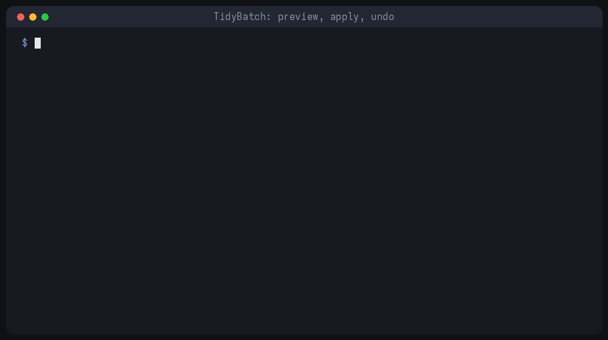

# TidyBatch

**Bulk rename files without the fear.** Preview every change, apply it, and undo it with one command.



[](https://github.com/tidybatch/tidybatch/actions/workflows/ci.yml)


Most bulk-rename scripts have a silent bug: renumber `1.txt 2.txt 3.txt` → `2.txt 3.txt 4.txt` and the first `mv` overwrites the original `2.txt`. TidyBatch is built around not doing that:

- **Dry run by default.** Nothing changes until you add `--apply`.
- **One-command undo.** Every applied run is journaled; `tidybatch undo <folder>` puts every file back.
- **Never overwrites.** Two-phase renames make chains and swaps safe; clashes get `_1`, `_2`, …
- **Case-insensitive collision checks**, because Windows and macOS treat `Photo.JPG` and `photo.jpg` as the same file.
- **One file, standard library only.** No dependencies: you can read all of it before you trust it with your photos.

New to bulk renaming? Read the tested guides at **[tidybatch.github.io/guides](https://tidybatch.github.io/guides/)**: how to rename safely on any OS, how to undo a bulk rename, and how to add dates to file names.

## Install

```bash
pipx install git+https://github.com/tidybatch/tidybatch
# or: uv tool install git+https://github.com/tidybatch/tidybatch
# or just download tidybatch.py and run: python3 tidybatch.py --help
```

Try it on a folder without installing anything permanent (it's a preview, so nothing changes):

```bash
uvx --from git+https://github.com/tidybatch/tidybatch tidybatch rename ~/Downloads --slug --lower
```

## Recipes

```bash
# Clean names: no accents, spaces or symbols, all lowercase
tidybatch rename ~/Downloads --slug --lower

# Number photos in date order: holiday_001.jpg, holiday_002.jpg, …
tidybatch rename ./photos -g "*.jpg" --sort date -t "holiday_{n:03}{ext}"

# Put the file date in front: 2024-08-12_invoice.pdf
tidybatch rename ./invoices -t "{date:%Y-%m-%d}_{stem}{ext}"

# Name photos by when they were TAKEN (EXIF): 2023-07-14_182205.jpg
tidybatch rename ./camera -t "{taken:%Y-%m-%d_%H%M%S}{ext}"

# Regex with groups: IMG_2024_0001.jpg -> 2024-photo-0001.jpg
tidybatch rename . --find "IMG_(\d{4})_(\d+)" --replace "\1-photo-\2"

# Happy with the preview? Run it for real, then change your mind
tidybatch rename ~/Downloads --slug --lower --apply
tidybatch undo ~/Downloads
```

**Template fields:** `{stem}` `{ext}` `{n}` (counter, e.g. `{n:03}`) `{date}` (modification date, e.g. `{date:%Y%m%d}`) `{taken}` (photo **date taken** from EXIF, falling back to `{date}`) `{today}` `{parent}` `{size_kb}`

**Options:** `-r` sub-folders · `-g "*.jpg"` filter · `--hidden` include hidden files · `--sort name|date|taken|size` · `--start N` · `--apply`

**Photo dates:** `{taken}` reads EXIF with the standard library only, with no Pillow or exiftool needed. Every CI run checks it against ExifTool on ExifTool's own sample images (JPEG, HEIC, TIFF, DNG, CR2, CR3, NEF, RW2, RAF: same date for every file, [dev/verify_exif.py](dev/verify_exif.py)) and feeds it 20,000 corrupted files, which must never crash or hang it ([dev/fuzz_exif.py](dev/fuzz_exif.py)). Dates stored only in XMP/IPTC aren't read; those files fall back to the modification date.

## How it stays safe

1. **Plan:** compute every new name without touching the disk, then resolve collisions. A destination is free only if nobody else claimed it *and* whatever is there now is itself moving away.
2. **Phase 1:** every file moves to a temporary name in the same folder.
3. **Phase 2:** every temporary file moves to its final name, refusing to overwrite anything that appeared in the meantime.
4. **Journal:** `<folder>/.tidybatch/journal-*.json` records each completed move, even if the run is interrupted, so `undo` can replay it backwards.

## How it's made

Most of the code was written with an AI coding agent. The behaviour that protects your files (two-phase moves, collision checks, undo) is pinned down by the test suite, which runs on Linux, macOS and Windows on every push.

## TidyBatch Pro

This repository is **TidyBatch Core** (rename + undo), free and MIT-licensed. **[TidyBatch Pro](https://whop.com/tidybatch/bulk-file-renamer/?utm_source=github&utm_campaign=tidybatch)** adds:

- `organize`: sort a folder into Images / Documents / Videos…, by year/month (modified **or photo date taken**), or by extension
- `dedupe`: find exact duplicates by content (SHA-256), keep the oldest, move the rest aside (never deleted)
- ready-to-run apps for **Windows and Linux** (no Python needed), plus free 1.x updates

Buying Pro also funds the free version. Thank you!

## Contributing

Bug reports with a reproducible folder layout are gold. Run the tests with:

```bash
python -m unittest discover -s tests

# photo-date checks (needs perl and an ExifTool checkout)
git clone --depth 1 https://github.com/exiftool/exiftool /tmp/exiftool
python dev/verify_exif.py /tmp/exiftool
python dev/fuzz_exif.py /tmp/exiftool
```

## License

[MIT](LICENSE)
